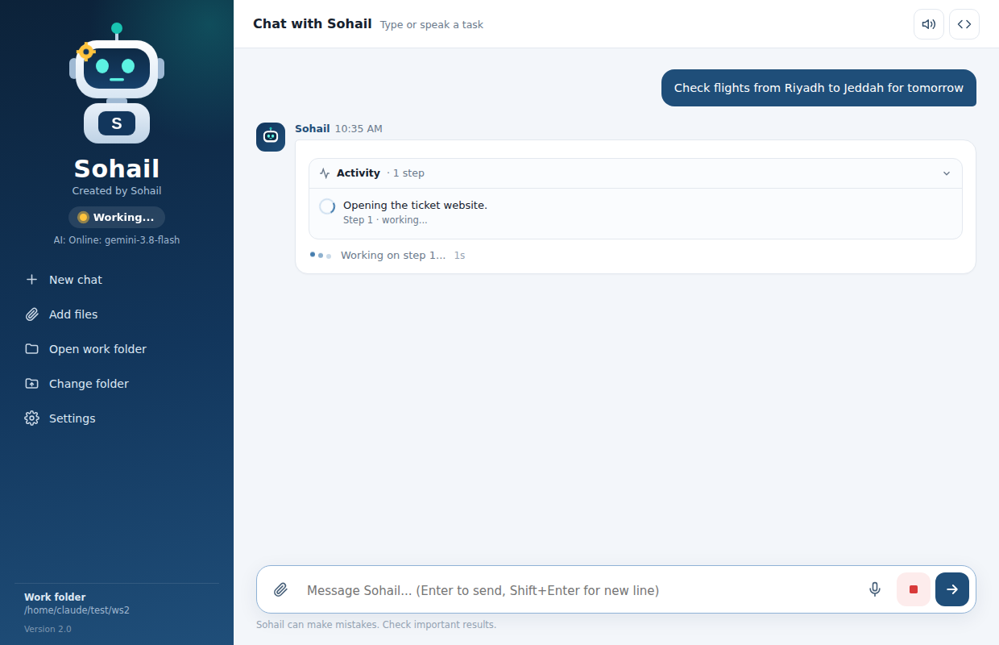

# Sohail AI Agent - Download

**Sohail** is a free AI agent robot for Windows. Type or speak a task and he does it step by step:

- **Excel and files:** make reports and charts, edit spreadsheets, merge files, remove duplicates, make Word reports
- **Web tasks in a real browser:** check tickets and prices, search for information, save results to Excel
- **Voice:** speak in English, Arabic, Urdu or Hindi; Sohail can read his answers aloud
- **Live progress:** see every step while he works

## ⬇️ Download

### [Download SohailAgent-Setup.exe (latest version)](https://github.com/testsohail1-tech/sohail-ai-agent-download/releases/latest/download/SohailAgent-Setup.exe)

All versions: [Releases page](../../releases)

## Install

1. Run **SohailAgent-Setup.exe** and click **Next → Install**. No admin rights are needed.
   - If Windows shows **"Windows protected your PC"**, click **More info → Run anyway**.
2. Open **Sohail AI Agent** from the desktop.
3. Click **Settings → Get free key**, sign in with Google, click **Create API key**, then copy the key and paste it in Settings. Click **Test**, then **Save**.
   - Or use **Offline** mode: install [Ollama](https://ollama.com/download). No internet is needed after setup.

## Requirements

- Windows 10 or 11
- Microsoft Edge (or Chrome) for web tasks
- Internet and a free Google Gemini key for Online mode

## Privacy

In Online mode, your messages and parts of your files and web pages are sent to Google's AI. On the free tier, Google may use this data to improve its products. Use Offline mode for confidential files.

---

© 2026 Sohail. All rights reserved. The app is free to download and use. The source code is not public. See [LICENSE](LICENSE).
